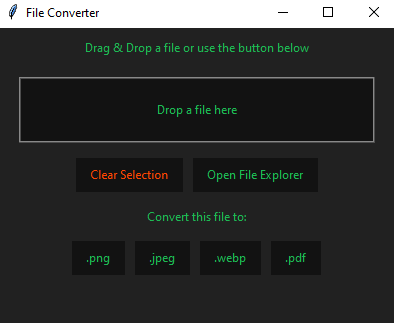

# 📄 File Converter

## 📌 Description

**File Converter** is a desktop GUI application written in Python for converting image and PDF files locally.

The application supports batch conversion, drag and drop, file selection through Windows File Explorer, progress tracking, cancellation, and merging multiple images into a single PDF.

All conversions are performed locally on the user's computer. Files are not uploaded to any external server.

## 🎨 Features

- ✅ Convert between **JPG/JPEG, PNG, WEBP, HEIC/HEIF and PDF**
- ✅ Convert PDF pages to separate **JPG, PNG or WEBP** files
- ✅ Convert images to PDF
- ✅ Merge multiple images into one PDF
- ✅ Batch conversion of multiple files
- ✅ Drag & Drop support
- ✅ File selection through Windows File Explorer
- ✅ Progress bar and conversion status
- ✅ Expandable operation log
- ✅ Cancel an active conversion
- ✅ Output files are saved in the same folder as the original file
- ✅ Existing files are not overwritten
- ✅ If a filename already exists, the application creates a new name such as:
  - `image.png`
  - `image_2.png`
  - `image_3.png`
- ✅ Dark graphical interface powered by `ttkbootstrap`
- ✅ Optional desktop shortcut and `.bat` launcher
- ✅ Automatic dependency installation

## 📂 Supported conversions

| Input format | Available output formats |
|---|---|
| JPG / JPEG | PNG, WEBP, HEIC, PDF |
| PNG | JPG, WEBP, HEIC, PDF |
| WEBP | JPG, PNG, HEIC, PDF |
| HEIC / HEIF | JPG, PNG, WEBP, PDF |
| PDF | JPG, PNG, WEBP |

When converting a PDF to an image format, every PDF page is saved as a separate file.

Example:

```text
document_page1.png
document_page2.png
document_page3.png
```

## 🧱 Project structure

```text
converter_app/
├── backend/
│   ├── __init__.py
│   ├── converter.py
│   ├── exceptions.py
│   ├── formats.py
│   └── pdf_service.py
├── frontend/
│   ├── __init__.py
│   └── app_window.py
├── services/
│   ├── __init__.py
│   └── conversion_worker.py
├── apprequirements.txt
├── main.py
└── requirements_installer.py
```

### Application layers

- `frontend/` — graphical interface, buttons, drag and drop, progress bar and messages
- `backend/` — file conversion and PDF processing logic
- `services/` — background worker, progress reporting and cancellation
- `main.py` — application entry point
- `requirements_installer.py` — dependency installer

## 🔧 Requirements

- Windows 10 or Windows 11
- Python **3.12 or newer**
- Python added to the system PATH, or a valid path to `python.exe` / `pythonw.exe`
- Required packages listed in `apprequirements.txt`

Dependencies should be installed automatically when the application starts.

They can also be installed manually:

```sh
pip install -r apprequirements.txt
```

## 📦 Main dependencies

The application uses:

- `Pillow`
- `pillow-heif`
- `PyMuPDF`
- `tkinterdnd2`
- `ttkbootstrap`

## 🚀 Running the application in a console

Open a terminal in the `converter_app` directory and run:

```sh
python main.py
```

On Windows, you may also use:

```sh
py main.py
```

Running the application in a console is recommended during development because Python errors remain visible.

## 🪟 Running the application without a console

Create a file named:

```text
start_converterapp.bat
```

Example content:

```bat
@echo off
set "APP_DIR=C:\Users\user1\Documents\GitHub\Side-quest\converter_app"
set "PYTHONW=C:\Users\user1\AppData\Local\Programs\Python\Python312\pythonw.exe"

cd /d "%APP_DIR%"
start "" "%PYTHONW%" "%APP_DIR%\main.py"
exit /b 0
```

Update `APP_DIR` and `PYTHONW` if your project or Python installation is located elsewhere.

Double-click `start_converterapp.bat` to launch the application without opening a console window.

## 🐞 Debug launcher

For troubleshooting, create:

```text
start_converterapp_debug.bat
```

Example content:

```bat
@echo off
set "APP_DIR=C:\Users\user1\Documents\GitHub\Side-quest\converter_app"
set "PYTHON=C:\Users\user1\AppData\Local\Programs\Python\Python312\python.exe"

cd /d "%APP_DIR%"
"%PYTHON%" "%APP_DIR%\main.py"
pause
```

This version keeps the console open and displays import errors, missing dependencies and Python tracebacks.

## 🔗 Creating a desktop shortcut

1. Right-click `start_converterapp.bat`.
2. Select **Show more options**.
3. Select **Send to → Desktop (create shortcut)**.
4. Rename the shortcut to **File Converter**.
5. Optionally assign a custom icon in the shortcut properties.

## 🖥️ Usage

1. Start the application.
2. Drag and drop one or more files into the drop area, or click **Open File Explorer**.
3. Choose the target format.
4. Wait for the conversion to finish.
5. The converted files will be saved next to the original files.

To merge images into one PDF:

1. Click **Open file explorer** under **Merge many images into one PDF**.
2. Select the images in the desired page order.
3. Select the destination and filename.
4. Wait for the PDF to be created.

## ⚠️ Notes

- The application does not overwrite existing output files by default.
- Conversion to the same format is skipped.
- PDF to image conversion can create multiple files.
- Large PDFs and high-resolution images may require more memory and processing time.
- Cancelling an operation may finish the currently processed file or PDF page before stopping.
- HEIC and HEIF support depends on `pillow-heif`.

## 📷 Example UI




Make sure the referenced files exist in the `Media` directory.

## 🛠️ Author

**jjhk-coag / Jakub Karczewski**